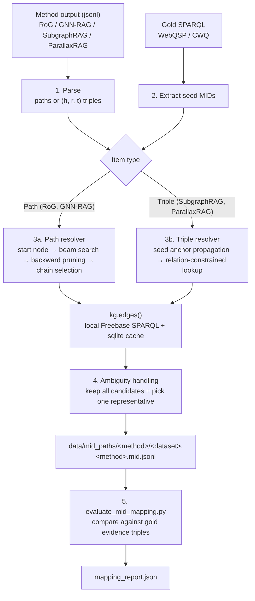

# kg-path2mid

Ground the **name-level reasoning paths and triples** produced by KG-based RAG methods (RoG, GNN-RAG, SubgraphRAG, ParallaxRAG) into **MID-level Freebase triples**.

Instead of looking names up in a `name → MID` dictionary, the pipeline **follows the relation edges in each path** to decide which entity each name refers to.

---

## Why

KG-RAG methods output entities by **surface name** only, e.g.

```
Annie → film.film.directed_by → Rob Marshall
```

In Freebase, one name often maps to many MIDs (a film, its soundtrack, an album, people who share the name, …). Among the evaluable triples, **84–94%** have a name with more than one MID. A naive name lookup that takes the first matching MID is correct only **29–41%** of the time.

This pipeline accepts a MID only if it **has the given name *and* is actually connected to the previous node by the relation stated in the path**.

## Pipeline



| File | Role |
| --- | --- |
| `src/mid_mapping/map_paths_to_mid.py` | Parsing, seed extraction, grounding, output (steps 1–4) |
| `src/mid_mapping/evaluate_mid_mapping.py` | Coverage and accuracy report (step 5) |

## Quick start

Requires a local Virtuoso Freebase SPARQL endpoint at `http://localhost:3001/sparql`.

```bash
python src/mid_mapping/map_paths_to_mid.py --method all --dataset all --workers 8
```

```bash
python src/mid_mapping/evaluate_mid_mapping.py
```

---

## How it works

### 1. Input parsing

| Method | Input block | Parsing |
| --- | --- | --- |
| RoG, GNN-RAG | `Reasoning Paths:`, one path per line | Split on `->`. Even positions are nodes, odd positions are relations (validated against the `a.b.c` pattern). |
| SubgraphRAG, ParallaxRAG | `Triplets:`, one `(h,r,t)` per line | Entity names may contain commas, so the relation pattern `,a.b.c,` is located first; everything before it is the head and everything after it is the tail. |

Malformed lines are kept and marked `parse_error` (0 in the current data).

### 2. Seed MIDs

- All constant `ns:m.xxx` MIDs in the gold SPARQL are collected per question. The `.P0` / `.P1` suffixes on question IDs are stripped and merged.
- Seeds include the topic entity **and constraint entities** (e.g. `basic_title = President`, `notable_types = Country`).
- Answer MIDs (`?x`) are variables, not constants, so they are **never** used.
- Each seed's English name is fetched and matched against path/triple names after normalization (whitespace cleanup, case-insensitive).

### 3. Core operation: grounding through edges (`kg.edges`)

`edges(src, rel, dst)` resolves a single hop in the KG. Each side is either an **anchor** (a set of MIDs) or **text**. Both forward and reverse directions are tried, since methods sometimes read a relation backwards.

Text sides are matched with the following modes, **strictest first**; the search stops at the first mode that returns results.

| Order | Mode | Meaning |
| --- | --- | --- |
| 0 | `mid` / `name` | The string is a MID, or exactly equals the English canonical name |
| 1 | `literal` | Matches a literal value (date, number, …) |
| 2 | `alias` | Matches `common.topic.alias` |
| 3 | `name_ci` | Any language, case-insensitive (loosest) |

> **Query safeguards.** `literal` and `name_ci` are post-hoc `FILTER`s, so they are only allowed when the other side is anchored to a MID set. If both sides would be loose, the hop is skipped to avoid scanning an entire relation. All SPARQL results are cached in sqlite.

### 3a. Path resolver (RoG, GNN-RAG)

1. **Start node.** Match the first node's name against seed names.
   - match → `seed`
   - the node is already a MID → `mid`
   - otherwise → `name_lookup`: search the KG using the first hop's relation and the next node's name.
2. **Forward beam search.** At each hop, keep every MID that is connected to some MID in the previous layer via relation `r` and whose name matches the next node.
3. **Seed homonym retry (`seed_homonym`).** If the seed has no matching edge **on the first hop**, restart from other entities with the same name.
4. **Backward pruning.** Walk back from the last layer and keep only edges that lie on a complete chain.
5. **Chain selection.** Enumerate up to 50 complete chains; if several remain, pick a representative (see [Ambiguity](#4-ambiguity-handling)).
6. **Broken paths.** If the chain breaks midway, the remaining hops are grounded independently, without the chain constraint (`path_broken`).

<details>
<summary>Example: <code>seed_homonym</code> — WebQTest-59, "when did annie open?"</summary>

- Gold seed: `m.01_1m4`, the **musical** *Annie*.
- RoG path: `Annie → film.film.directed_by → Rob Marshall` (RoG predicted John Huston and Rob Marshall, which is wrong).
- The musical has no `directed_by` edge, so the first hop fails. The resolver looks for an entity named *Annie* linked to Rob Marshall via `directed_by` and re-grounds from the **film** *Annie* (`m.03c49zn`).
- The method's name-keyed graph had merged the two *Annie*s into one node. A `seed_homonym` resolution is therefore **a signal of entity confusion by the method**; it occurs in about 1–1.6% of paths.

</details>

### 3b. Triple resolver (SubgraphRAG, ParallaxRAG)

1. **Initialize anchors** as `{seed name: seed MID}`.
2. **Propagate anchors (iterate).** For each triple whose head or tail is a known anchor, fix that side to its MIDs and call `edges()` (forward first, reverse only if forward fails). The opposite entity of each resolved triple becomes a **new anchor**. Repeat until no new triple resolves. This works like a BFS from the seeds over the retrieved subgraph (`anchored_head` / `anchored_tail`).
3. **Remaining triples (`relation_constrained`).** Resolve with both sides as text: `?h name H . ?h r ?t . ?t name T`. Because the relation's domain and range must match, type constraints alone remove most homonyms.

### 4. Ambiguity handling

When several candidates satisfy all constraints:

- **All candidates are recorded:** `status = ambiguous`, `n_candidates`, `candidates` (up to 20).
- **One representative is picked**, with the reason stored in `pick`:
  1. `sample_consistency`: prefer the candidate that contains more MIDs already confirmed elsewhere for the same question (seeds, for paths).
  2. `degree_tiebreak`: prefer the candidate whose MIDs have the larger total out-degree (i.e. the more prominent entity).

### 5. Output format

`data/mid_paths/<method>/<dataset>.<method>.mid.jsonl`, one line per question. Each grounded triple looks like:

```json
{"subject":   {"kind": "entity", "id": "m.03_r3", "surface": "Jamaica", "name": "Jamaica"},
 "predicate": "location.country.languages_spoken",
 "object":    {"kind": "entity", "id": "m.01428y", "surface": "Jamaican English", "name": "Jamaican English"},
 "direction": "forward",
 "match": "name",
 "resolution": "anchored_head",
 "status": "resolved"}
```

- Triples are always stored in the **direction they exist in the KG**. `direction: "reverse"` means the method read the triple backwards.
- `surface` is the string output by the method; `name` is the canonical KG name.
- Path-level `status` is one of `resolved`, `ambiguous`, `partial` (broken midway), `unresolved`, `parse_error`.

---

## Evaluation

`evaluate_mid_mapping.py` compares the output with **gold evidence triples** (with MIDs) that the mapper never sees.

- **Evaluable triple:** a predicted triple whose (subject name, relation, object name) matches a gold triple. It counts as correct if (subject MID, object MID) also match.
- **Baselines** map the same triples by name only:
  - `naive_first`: the first MID with that name
  - `naive_degree`: the highest-degree MID with that name

| Dataset / Method | Grounded | Resolved | Evaluable | **Ours** | naive_first | naive_degree |
| --- | ---: | ---: | ---: | ---: | ---: | ---: |
| WebQSP / RoG | 99.99% | 96.6% | 4,456 | **99.96%** | 28.8% | 94.6% |
| WebQSP / GNN-RAG | 99.99% | 96.9% | 5,440 | **99.96%** | 34.8% | 93.7% |
| WebQSP / SubgraphRAG | 99.97% | 99.2% | 8,210 | **99.99%** | 33.8% | 94.1% |
| WebQSP / ParallaxRAG | 99.98% | 98.8% | 8,080 | **99.99%** | 36.2% | 94.0% |
| CWQ / RoG | 100.0% | 95.7% | 4,342 | **100.00%** | 29.3% | 81.9% |
| CWQ / GNN-RAG | 99.97% | 96.1% | 8,654 | **99.99%** | 34.9% | 83.2% |
| CWQ / SubgraphRAG | 99.97% | 99.1% | 8,713 | **99.92%** | 41.1% | 90.6% |
| CWQ / ParallaxRAG | 99.97% | 98.8% | 8,700 | **99.78%** | 40.4% | 89.7% |

- **Grounded** = resolved + ambiguous, i.e. triples with at least one MID found. **Resolved** = exactly one candidate.
- For ambiguous triples, the gold MID is almost always **within the candidate list** (exceptions: 1 triple for CWQ / SubgraphRAG, 8 for CWQ / ParallaxRAG).
- Accuracy is measured only on evaluable triples, i.e. those overlapping with gold paths.

## Limitations

- **Seeds use gold information.** Constraint entities from the gold SPARQL are used as seeds in addition to the topic entity, so grounding has more information than the method itself had.
- **Name matching.** Seeds are matched to the first path node by normalized English name. Variant spellings (e.g. `James K. Polk` vs. `James Polk`) miss the seed and fall back to `name_lookup`.
- **Tie-breaking is heuristic.** The representative of an ambiguous triple is chosen by a degree-based heuristic. For correctness judgments, use the full `candidates` list rather than the single pick.
- **Infrastructure.** A local Virtuoso Freebase endpoint (`localhost:3001/sparql`) is required.
